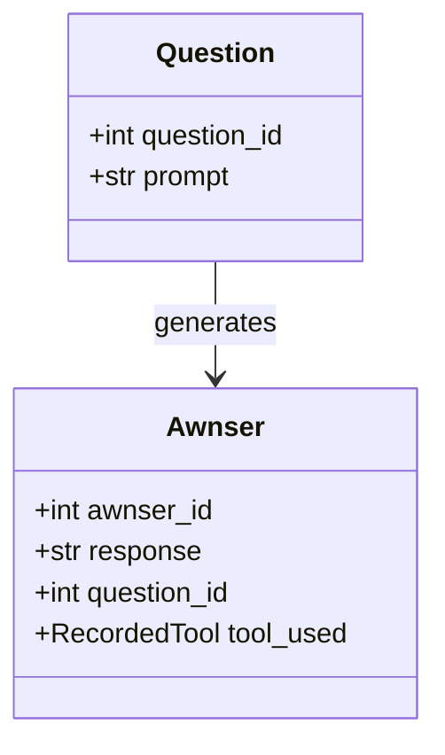
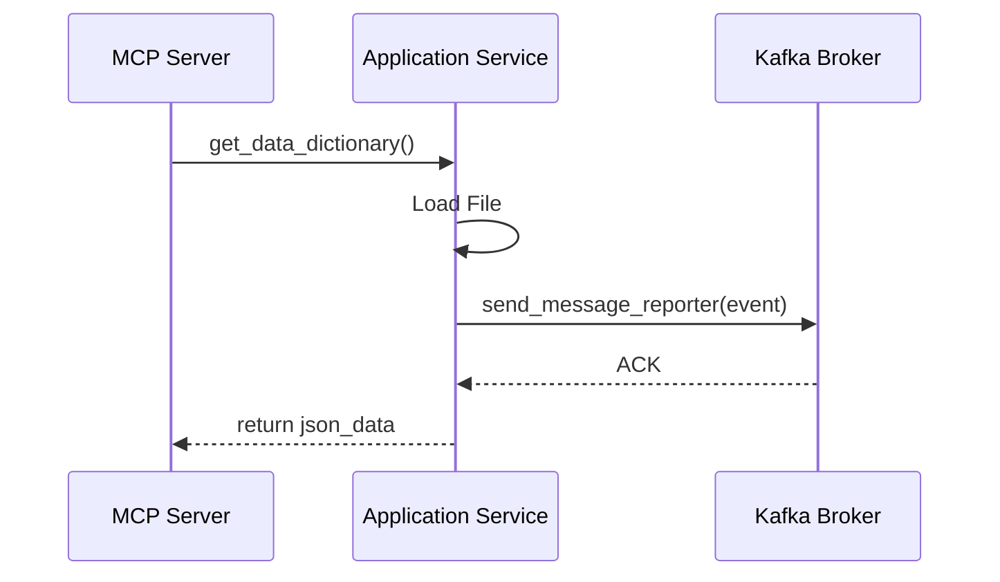

# Project Review: MCP Server (mcps1)

## 1. Technologies, Design Patterns, and Architecture

### Technologies
*   **Language:** Python 3.14.4
*   **Package Manager & Server:** `uv` 0.12.1
*   **Interface/Framework:** `FastMCP` (built on top of FastAPI concepts) for implementing the Model Context Protocol (MCP).
*   **Messaging:** `kafka-python` 3.0.11 for asynchronous communication (Producer/Consumer pattern).
*   **Dependency Injection:** `fast-depends` 3.0.9.
*   **Persistence:** `psycopg2` for PostgreSQL interaction.
*   **Data Validation:** `Pydantic` for models and DTOs.
*   **Environment Management:** `python-dotenv` for configuration.

### Design Patterns
*   **Hexagonal Architecture (Ports and Adapters):** The project strictly separates the core business logic (Domain) from application services (Application) and external technical details like databases or message brokers (Infrastructure).
*   **Dependency Injection (DI):** Extensive use of `fast-depends` to decouple components, making the system highly testable and modular.
*   **Adapter Pattern:** Implementation of `ResourcePortOut` and `KafkaPortOut` to bridge the domain logic with external infrastructure (Kafka, File System, etc.).
*   **Observer / Event-Driven Pattern:** Uses Kafka to publish events (e.g., resource dictionary definitions) to allow other services to react asynchronously.
*   **Command/Tool Pattern:** The MCP server exposes specific tools (`prime`, `collatz`, `hello`) as executable commands for an AI model.

### Architecture
The architecture follows the **Hexagonal** standard:
1.  **Domain Layer:** Pure business logic and entities. It has no dependencies on external libraries (except Pydantic for data structures).
2.  **Application Layer:** Orchestrates the flow of data. Defines "Ports" (interfaces) that the domain needs.
3.  **Infrastructure Layer:** Implements the "Adapters" for those ports. It handles the "how" (how to talk to Kafka, how to serve the MCP interface).

---

## 2. Project Utility
The project acts as an **MCP Server**. Its primary purpose is to provide an interface for AI models (like Claude or others) to interact with specific tools and resources. It allows an AI to:
*   Perform mathematical operations (via `MathGames`).
*   Retrieve contextual data dictionaries (via `ResourceManagement`).
*   Interact with a messaging system (Kafka) to trigger or respond to asynchronous events in a larger ecosystem.

---

## 3. File Tree and Responsibilities

```text
mcps1/
├── pyproject.toml          # Project metadata and dependencies (managed by uv)
├── src/
│   └── mcps1/
│       ├── main.py         # Entry point for the MCP server
│       ├── domain/         # CORE: Entities and business rules
│       │   ├── question/   # Question models
│       │   ├── response/   # Answer/Response models
│       │   ├── resources/  # Resource entity definitions
│       │   └── emun/       # Enums and fixed data structures (FamilyResource, etc.)
│       ├── application/    # ORCHESTRATION: Use cases and Ports
│       │   ├── resources/  # Application services and resource ports (In/Out)
│       │   │   └── adapters/ # Implementations of application-level logic
│       │   ├── tools/       # Business logic for MCP tools (e.g., MathGames)
│       │   └── utils.py    # Application-level utilities
│       └── infraestructure/# ADAPTERS: Technical implementations
│           ├── mcp/         # MCP Server implementation (Controller/Interface)
│           ├── messaging/   # Kafka implementation (Producer/Consumer/DTOs)
│           │   ├── adapters/
│           │   ├── kafka_workers/
│           │   └── ports/
│           └── __init__.py
└── test/                   # TESTING: Test suites for all layers
    ├── mcps1/             # Mirror of src/mcps1 for testing
    └── utils_resources.py  # Test utilities
```

---

## 4. Detailed Block Analysis

### A. Domain Block (The Core)
**Responsibility:** Represents the "truth" of the business. It defines what a `Question`, an `Answer`, and a `Resource` are.

**Main Entities:**
*   `Question`: Represents a user's input/prompt.
*   `Awnser`: Represents the result of an interaction, including tool usage and token costs.
*   `FamilyResource`: An Enum defining the types of resources available (MESSAGE, DATABASE, etc.).

**UML Concept (Simplified):**


### B. Application Block (The Orchestrator)
**Responsibility:** Implements the business rules and coordinates the flow between the domain and the infrastructure.

**Key Components:**
*   **`ResourcesAssignation` (Service/Adapter):** This is the "brain" for resource management. It implements `ResourcePortOut`. It performs high-level tasks like loading resource schemas and publishing events to Kafka.
*   **`MathGames` (Tool Logic):** Encapsulates the logic for mathematical tools exposed to the AI.

**Design Pattern Implementation:**
*   **Port/Adapter:** Defines `ResourcePortOut` as an interface, allowing the `ResourcesAssignation` to be swapped or mocked in tests.

### C. Infrastructure Block (The Technical Interface)
**Responsibility:** Handles communication with the outside world.

**Key Components:**
*   **`mcp/server.py` (MCP Controller):** The entry point for the MCP protocol. It maps MCP tools/resources to Application Services.
*   **`messaging/kafka_producer.py`:** The low-level implementation of sending messages to Kafka.
*   **`messaging/kafka_consumer_update.py`:** A background worker that listens to Kafka topics to react to external events.

**UML Concept (Messaging Flow):**


---
*Review generated by Gemma-4-26b-a4b-qat*
